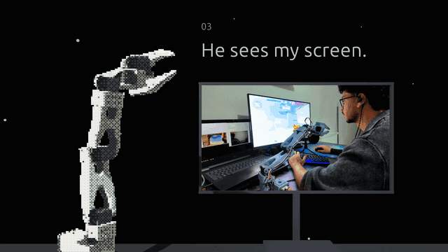
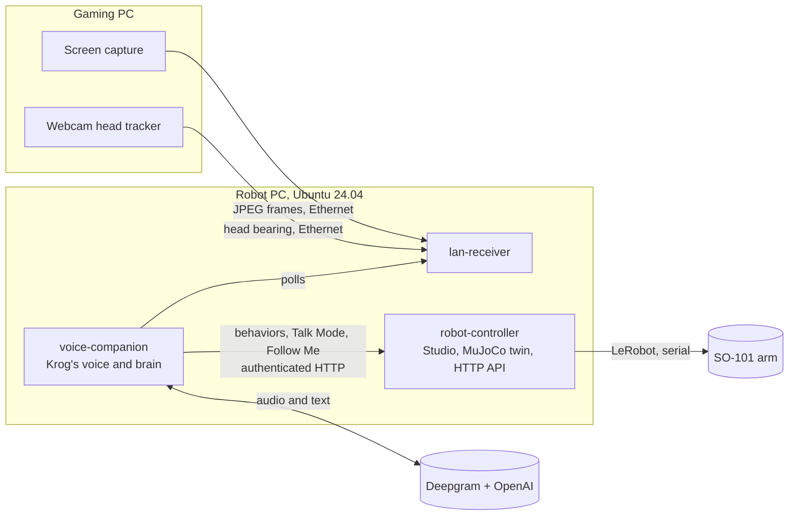
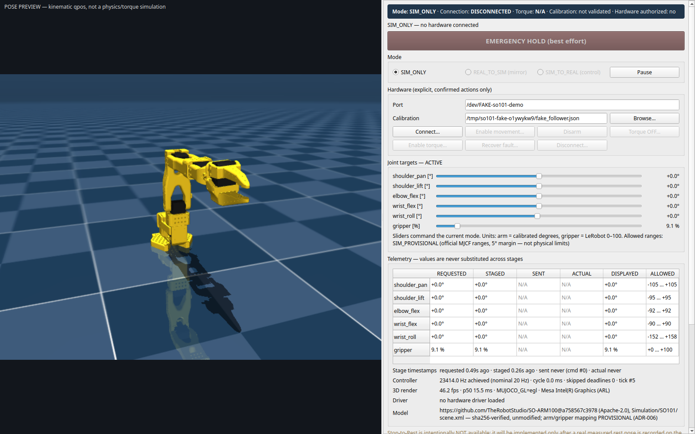
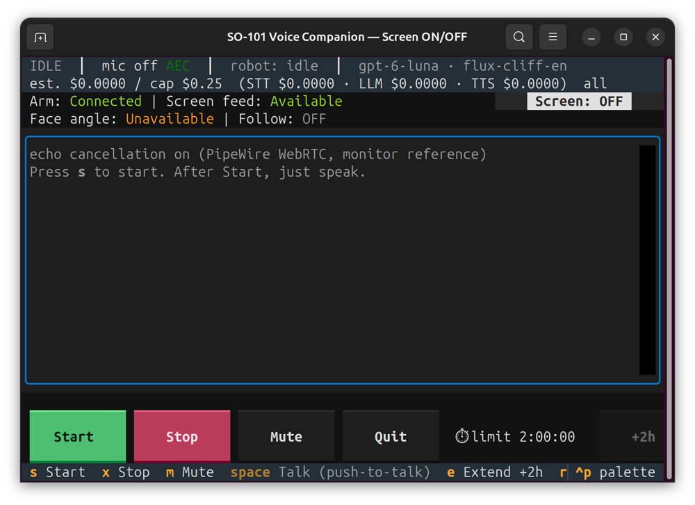

# Krog: an AI gaming companion in an SO-101 robot arm

Krog sits on my desk while I play Valorant. He listens and answers out loud, turns to find my face when I
speak, looks at my game screen, and moves with a personality of his own: a gripper that "talks" while he
speaks and a library of recorded gestures he picks to match what he says.

[](docs/media/krog-demo.mp4)

**[▶ Watch the 60-second demo](docs/media/krog-demo.mp4)**. Every exchange in it is real and unscripted; the
pauses while he thinks are sped up and labelled.

## What he does

| | How |
|---|---|
| **Talks back in real time** | Streaming speech-to-text (Deepgram Flux) → LLM (OpenAI Responses API, streaming) → text-to-speech (Deepgram Flux TTS). The first sentence plays while the rest is still being written, and you can interrupt him at any moment. |
| **Works with an open mic and speakers** | PipeWire's WebRTC echo canceller removes everything the speakers play (his voice, game audio) from what speech recognition hears. No headphones needed. |
| **Moves with personality** | The same LLM reply that writes his words picks a gesture from a library of recorded arm behaviors. While he speaks, the gripper animates (Talk Mode). |
| **Follows your head** | The gaming PC estimates head bearing from the webcam and sends the angle for Follow Me. |
| **Sees your screen** | The gaming PC sends a screenshot every few seconds over a private Ethernet link; Krog comments when he has something worth saying. |
| **Keeps costs and the arm in check** | A live cost meter with a hard per-session budget, sessions that end on their own after 2 hours, and a robot controller that alone owns the hardware (see below). |

## How it fits together



The voice companion never opens a serial port or sends motor commands. It asks the robot controller,
which runs a single control loop with calibrated joint limits, explicit hardware authorization, latched
faults and an emergency hold.

## Repository layout

| Folder | What it is | Tests |
|---|---|---|
| [`robot-controller/`](robot-controller/) | The SO-101 controller: Studio desktop app with a MuJoCo digital twin, safety-gated real-arm control through LeRobot, behavior recording and replay, named poses, Follow Me and Talk Mode, and an authenticated HTTP/WebSocket API. Built spec-first: specifications, 19 architecture decision records and commissioning reports from the real arm. | 479 offline |
| [`voice-companion/`](voice-companion/) | Krog himself: the real-time voice pipeline, the character, the robot tools the LLM can call, screen observation and Follow Me through the LAN receiver, and a terminal UI with cost tracking. | 256 offline |
| [`lan-receiver/`](lan-receiver/) | A small FastAPI service on the robot PC that receives screenshots and head bearings from the gaming PC over a private Ethernet link, with a shared token. | 8 |
| [`01_GamingPC_ScreenSender/`](01_GamingPC_ScreenSender/) | Desktop app that previews a selected display and sends a JPEG every two seconds by default. | |
| [`02_GamingPC_FaceTracker/`](02_GamingPC_FaceTracker/) | Desktop app that uses MediaPipe to send head bearings. It estimates the position from the visible torso when the face is hidden. | 21 offline |

<p>
  
  
</p>

## Hardware

- SO-101 follower arm ([LeRobot](https://github.com/huggingface/lerobot) build), calibrated.
- An Ubuntu 24.04 PC with a microphone and speakers (the robot PC).
- Optional, for screen and head tracking: a gaming PC with a webcam, linked to the robot PC by a private
  Ethernet cable. Set up the [LAN receiver](lan-receiver/) and use its shared token in both sender apps.

## Quick start

Each folder has its own README with full setup. In short:

```bash
# 1. Robot controller: rehearse with a fake arm before touching the real one
cd robot-controller
uv venv --python /usr/bin/python3.12 .venv
uv pip sync --python .venv/bin/python --torch-backend cpu requirements/hardware-linux-x86_64-py312.lock
uv pip install --python .venv/bin/python --no-deps -e .
.venv/bin/python scripts/fetch_model_assets.py           # official SO-101 model, pinned and hash-checked
.venv/bin/python -m so101_companion --create-api-token krog
.venv/bin/python -m so101_companion --fake-hardware --api

# 2. Voice companion, in another terminal
cd voice-companion
uv venv --python /usr/bin/python3.12 .venv
uv pip install --python .venv/bin/python -e '.[dev]'
cp .env.example .env                                     # add DEEPGRAM_API_KEY, OPENAI_API_KEY, SO101_API_TOKEN
.venv/bin/so101-voice
```

The API keys stay in `.env`, which git ignores. Live sessions use paid APIs; the default budget is
$0.25 per session.

> **Safety.** The real arm moves fast enough to hurt or break things. Start with `--fake-hardware`, keep
> the arm clear of people and objects, and read
> [`robot-controller/COMMISSIONING_GUIDE.md`](robot-controller/COMMISSIONING_GUIDE.md) before connecting
> it. Emergency Hold is best effort, not a certified emergency stop.

## Running the tests

```bash
(cd robot-controller && .venv/bin/python -m pytest)
(cd voice-companion && .venv/bin/python -m pytest)
(cd lan-receiver && .venv/bin/python -m pytest)
(cd 02_GamingPC_FaceTracker && .venv/bin/python -m pytest)
```

The suites run offline. Robot and voice tests use fake hardware and providers.

## How it was built

The robot controller started from interviews turned into specifications, then milestones with explicit
acceptance gates. Every design decision is recorded in
[`robot-controller/decisions/`](robot-controller/decisions/), and real-arm sessions are written up in
[`robot-controller/IMPLEMENTATION_STATUS.md`](robot-controller/IMPLEMENTATION_STATUS.md). The code was
written with AI coding agents working from those specs (their instructions are in `AGENTS.md` and
`CLAUDE.md`). Architecture notes for the voice side are in
[`voice-companion/docs/ARCHITECTURE.md`](voice-companion/docs/ARCHITECTURE.md).

## Credits

- [LeRobot](https://github.com/huggingface/lerobot) for the SO-101 driver, and
  [TheRobotStudio/SO-ARM100](https://github.com/TheRobotStudio/SO-ARM100) for the arm and its official
  MuJoCo model (fetched at a pinned commit, not redistributed).
- [MuJoCo](https://github.com/google-deepmind/mujoco) for the digital twin.
- [SO-101-VR-Control](https://github.com/kabilankb/SO-101-VR-Control) (MIT) for the joint-limit arithmetic
  the controller adapts.
- Deepgram and OpenAI for speech and language.

Full third-party licences: [`robot-controller/THIRD_PARTY_NOTICES.md`](robot-controller/THIRD_PARTY_NOTICES.md).

## Licence

[Apache-2.0](LICENSE). Valorant is a trademark of Riot Games; this project is not affiliated with Riot.
