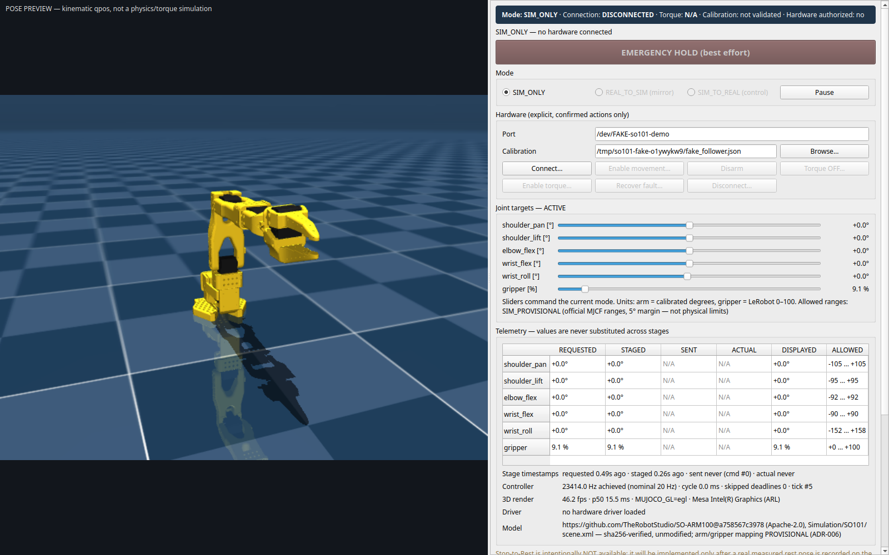

# Robot controller: SO-101 Studio, digital twin and API

The part of [Krog](../README.md) that owns the arm. One desktop app (the Studio) shows the official SO-101
MuJoCo model next to the real arm, drives the arm through LeRobot with calibrated limits, records and replays
gestures, and exposes an authenticated HTTP/WebSocket API so other programs (like the voice companion) can ask
for movement without ever touching the serial port.



## Features

- **Digital twin:** the official SO-101 MuJoCo model, fetched at a pinned commit and hash-checked, mirrors
  the real arm (`REAL_TO_SIM`) or drives it (`SIM_TO_REAL`). It starts in `SIM_ONLY` and never connects by
  itself.
- **Safety:** calibrated joint bounds with a 5° margin, explicit confirmation before connecting, enabling
  movement or torque, latched communication faults with manual recovery, Emergency Hold and Torque Off. One
  control loop owns the arm; everything else sends requests to it.
- **Behaviors and poses (M2):** record gestures by moving the arm by hand, edit and replay them, save named
  poses, and return to a measured rest pose.
- **HTTP/WebSocket API (M2.5):** token-authenticated, bound to `127.0.0.1` by default. See
  [`docs/HTTP_API.md`](docs/HTTP_API.md) and the client in [`examples/api_client.py`](examples/api_client.py).
- **Follow Me and Talk Mode (M2.6):** two overlays merged into the control loop: the base pan tracks a target
  angle (a face), and the gripper animates while the companion speaks.

## Quick start (Ubuntu 24.04, Python 3.12)

```bash
uv venv --python /usr/bin/python3.12 .venv
uv pip sync --python .venv/bin/python --torch-backend cpu requirements/hardware-linux-x86_64-py312.lock  # or dev-…lock for sim only
uv pip install --python .venv/bin/python --no-deps -e .
.venv/bin/python scripts/fetch_model_assets.py      # official SO-101 model, pinned and sha256-verified
.venv/bin/python -m pytest                          # headless offline suite
.venv/bin/python -m so101_companion                 # the Studio; starts in SIM_ONLY, never auto-connects
.venv/bin/python -m so101_companion --fake-hardware # rehearse the hardware workflow with a fake robot
.venv/bin/python -m so101_companion --create-api-token my-agent  # API token (shown once)
.venv/bin/python -m so101_companion --api           # Studio + authenticated HTTP API on 127.0.0.1:8765
```

Setup details: [`milestone-1/runbooks/UBUNTU_SETUP.md`](milestone-1/runbooks/UBUNTU_SETUP.md). Before
connecting a real arm, read [`COMMISSIONING_GUIDE.md`](COMMISSIONING_GUIDE.md).

## Status

What has and has not been verified on the real arm is tracked in
[`IMPLEMENTATION_STATUS.md`](IMPLEMENTATION_STATUS.md), session by session.

## How this project is organized

It was built spec-first, with AI coding agents implementing one task at a time from approved specifications.

| Where | What |
|---|---|
| [`PROJECT_CONTEXT.md`](PROJECT_CONTEXT.md), [`CONSTITUTION.md`](CONSTITUTION.md) | Scope, terminology and the non-negotiable safety principles |
| [`milestone-1/`](milestone-1/), [`planning/`](planning/) | Specifications, architecture, contracts, task lists and acceptance tests per milestone |
| [`decisions/`](decisions/) | 19 architecture decision records (ADR-001 to ADR-019) |
| [`research/`](research/) | Audited upstream sources, risks and unknowns |
| [`docs/evidence/`](docs/evidence/) | Screenshots and metrics from verification runs |
| [`AGENTS.md`](AGENTS.md), [`CLAUDE.md`](CLAUDE.md) | Instructions given to the coding agents |

## Third-party code and models

The upstream model files are not redistributed: [`scripts/fetch_model_assets.py`](scripts/fetch_model_assets.py)
downloads them into `vendor/` (git-ignored). Sources, pinned revisions and licences are listed in
[`THIRD_PARTY_NOTICES.md`](THIRD_PARTY_NOTICES.md).
